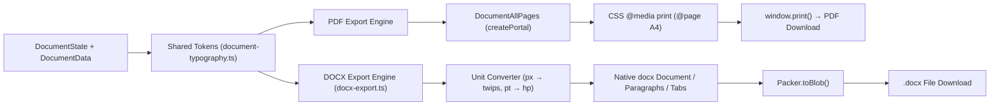

# Documaxxer — Export System & Document Parity

This document describes the dual export pipeline in Documaxxer: **Native DOCX Generation** via the `docx` library and **Clean Print-Based PDF Generation** via the browser print engine, along with the shared typography tokens and unit conversions connecting them.

---

## 1. Export Architecture Overview

Documaxxer supports two export formats directly within the client browser without external server processing or cloud rendering services:



---

## 2. Print-Based PDF Export Pipeline

PDF export is triggered via the [`GenerateButton`](file:///e:/Github/Documaxxer/components/builder/preview/generate-button.tsx) component:

### Implementation Details
1. **Print Portal Mounting**:
   [`DocumentPrintPortal`](file:///e:/Github/Documaxxer/components/builder/preview/document-preview-container.tsx) uses `ReactDOM.createPortal` to attach the [`DocumentAllPages`](file:///e:/Github/Documaxxer/components/builder/preview/document-preview.tsx#L409) component directly to `document.body`.
2. **Identical Pagination**:
   `DocumentAllPages` consumes the exact same [`useDocumentPages()`](file:///e:/Github/Documaxxer/components/builder/preview/document-preview.tsx#L62) hook calculation as the interactive preview. Blocks are divided across pages using identical measurements.
3. **Print Media CSS Rules**:
   Defined in [`styles/globals.css`](file:///e:/Github/Documaxxer/styles/globals.css#L92-L120):
   ```css
   @media print {
     @page {
       size: A4;
       margin: 0;
     }
     html, body {
       background: #ffffff !important;
       margin: 0 !important;
       padding: 0 !important;
     }
     .print-only, .print-only * {
       -webkit-print-color-adjust: exact;
       print-color-adjust: exact;
     }
     .print-only h2, .print-only h3, .print-only p,
     .print-only li, .print-only span, .print-only a {
       color: #000000 !important;
     }
     .print-only [style*="border"], .print-only h3, .print-only header {
       border-color: #000000 !important;
     }
   }
   ```
4. **UI Chrome Suppression**:
   In print mode, all application headers, buttons, form controls, and theme containers are hidden (`hidden print:block` on `.print-only`), ensuring only pure A4 paper sheets are printed.

---

## 3. Native OOXML DOCX Export Pipeline

DOCX export is implemented in [`lib/export/docx-export.ts`](file:///e:/Github/Documaxxer/lib/export/docx-export.ts) using the `docx` library (v9.7.1).

### Key Architectural Traits
- **Genuinely Editable**: Generates real Microsoft Word OpenXML objects (`Document`, `Paragraph`, `TextRun`, `TabStop`).
- **No Screenshots or HTML Hacks**: Does NOT export images or web views wrapped in `.docx` containers.
- **Client-Side Binary Packing**: Packages OOXML into a binary buffer in the browser using `Packer.toBlob(doc)` and downloads via an invisible DOM anchor (`<a>`).

### OOXML Structure Mapping

| Document Element | Preview CSS Representation | Native DOCX Implementation |
| :--- | :--- | :--- |
| **Page Size** | 210mm × 297mm | `convertMillimetersToTwip(210)` × `convertMillimetersToTwip(297)` |
| **Page Margins** | 25.4mm (1.0 inch) | `convertMillimetersToTwip(25.4)` on all sides |
| **Candidate Name** | `fontSize: "22pt"`, bold | `Paragraph` with `TextRun(size: NAME_HP, bold: true)` |
| **Section Headings**| `fontSize: "11pt"`, uppercase, bottom border | `Paragraph` with `border: { bottom: { style: BorderStyle.SINGLE } }` |
| **Dates & Location**| Flex container `justifyContent: "space-between"` | `Paragraph` with `tabStops: [{ type: TabStopType.RIGHT, position: TabStopPosition.MAX }]` |
| **Bullet Points** | `<ul><li>` list items | `Paragraph` with `bullet: { level: 0 }` |

---

## 4. Shared Typography & Unit Conversion

To ensure visual parity, DOCX generation shares the typography constants in [`lib/documents/document-typography.ts`](file:///e:/Github/Documaxxer/lib/documents/document-typography.ts):

### Typographic Points vs Half-Points (hp)
OpenXML specifies font sizes in **half-points** (`1 pt = 2 hp`):
- `NAME_PT = 22` → `NAME_HP = 44`
- `SECTION_HEADING_PT = 11` → `SECTION_HEADING_HP = 22`
- `ENTRY_TITLE_PT = 10` → `ENTRY_TITLE_HP = 20`
- `BODY_PT = 10` → `BODY_HP = 20`
- `CONTACT_PT = 10` → `CONTACT_HP = 20`
- `DATE_PT = 10` → `DATE_HP = 20`

### CSS Pixels to Twips Conversion
A **twip** is a twentieth of an imperial point (`1/1440` of an inch). At standard 96 DPI CSS rendering:
- `1 inch = 96 CSS-px = 1440 twips` → **`1 CSS-px = 15 twips`** (`PX_TO_TWIP = 15`)

Spacing conversions:
- **Heading Top Margin**: `14px * 15 = 210 twips` (`SECTION_HEADING_BEFORE`)
- **Heading Bottom Padding**: `4px * 15 = 60 twips` (`SECTION_HEADING_AFTER`)
- **Entry Top Margin**: `8px * 15 = 120 twips` (`ENTRY_BEFORE`)
- **Bullet Margin Bottom**: `2px * 15 = 30 twips` (`BULLET_AFTER`)
- **Body Line Height (1.5×)**: `Math.round(10pt * 20 twips * 1.5) = 300 twips` (`BODY_LINE_SPACING`)

---

## 5. Shared Layout Rules (single source of truth)

[`lib/documents/document-layout.ts`](../lib/documents/document-layout.ts) is imported by the preview, the print view and the DOCX exporter so every output agrees:

- `getResumeLayout(templateId, optionalSections)` — header alignment, main/sidebar section order per template. Optional sections fill the template's optional slots in the order the user dragged them in the builder.
- `selectVisibleEntries(document)` — the filtered, recency-sorted entries that actually render (sections the user has not added are empty).
- `buildLetterContent(...)` / `getLetterStyle(templateId)` — letter structure and the three letter styles (classic, modern, minimal).
- `getExportBaseName(document, type)` — file names such as `Juan_Dela_Cruz_Resume.docx`; PDF uses the same name as the print-dialog title.

Pagination (`paginateBlocks`) is a single greedy pass: blocks are atomic, a heading always stays with the following block, and a block taller than a page gets its own (clipped) page instead of looping.

## 6. Parity Status & Known Discrepancies (Milestone 10)

| Feature / Attribute | Preview | PDF (Print) | Native DOCX | Parity |
| :--- | :--- | :--- | :--- | :--- |
| **All 20 resume/CV sections** | ✓ | ✓ | ✓ | ✅ 1:1 |
| **Section order (template + user order)** | ✓ | ✓ | ✓ | ✅ 1:1 |
| **Header alignment per template** | ✓ | ✓ | ✓ | ✅ 1:1 |
| **Two-column sidebar (Executive, Professional)** | 35% / 65% grid | Same | Borderless 2-column table, shaded rail | ✅ Close match |
| **Links** | Anchors | Anchors | Real hyperlinks | ✅ 1:1 |
| **Letters (cover, authorization, excuse) × 3 styles** | ✓ | ✓ | ✓ | ✅ 1:1 |
| **Font selection** | CSS stack | CSS stack | First font name | ✅ 1:1 |
| **Line heights / spacing** | CSS (1.5 line-height) | Same | Explicit point line heights, kerning on | ✅ Within ~4pt per page |
| **Page breaks** | DOM measured | Identical to preview | Word's own flow (`keepNext` on headings) | ⚠️ Minor variations |
| **Skill chips (Modern Tech)** | Chips | Chips | Bullet-separated line | ⚠️ Visual only |
| **Bullet glyph** | CSS disc | CSS disc | Word's default bullet symbol | ⚠️ Visual only |

**Measured parity (2026-10-31)** — sample documents exported from the app, the PDF printed by Chromium and the DOCX rendered by Microsoft Word 16, compared line by line:

| Document | Max vertical drift vs. preview | Mean |
| :--- | :--- | :--- |
| Cover letter (modern) | 1.8pt | 1.0pt |
| Executive resume (two-column) | 2.5pt | 1.2pt |
| ATS Classic resume | 4.3pt | 2.5pt |

The PDF is printed from the preview's own render tree, so it matches the preview exactly. Word lays text out itself, so an occasional line can wrap one word earlier.

PDF export is available from any viewport: the pagination instance and its measuring container are always mounted (portaled to `<body>`), so printing works even while the side preview pane is hidden below the `xl` breakpoint. The dashboard "PDF" action opens `/builder?document=<id>&export=pdf`, which loads the saved document and opens the print dialog.

## 7. Visual Template Export (template builder)

- **PDF** — [`VisualPrintPages`](../components/templates/visual-block.tsx) renders every page at true pixel size with the same `VisualBlockContent` renderer as the editor canvas. `visualPrintPageCss` injects named `@page` rules so each page prints at its own size (A4, Letter or custom).
- **DOCX** — [`lib/export/visual-docx-export.ts`](../lib/export/visual-docx-export.ts): each page becomes its own section with the exact page size and zero margins. Text, headings, shapes, dividers, signatures and tables become floating tables positioned at the block's absolute page coordinates (text stays editable); images become floating pictures. Uploaded images are normalized to PNG (max 1600 px) so both outputs can embed them.
- **Known DOCX limitations** — rounded corners and opacity are not reproduced; text that overflows a fixed-height block is clipped; Word may substitute fonts that are not installed.
